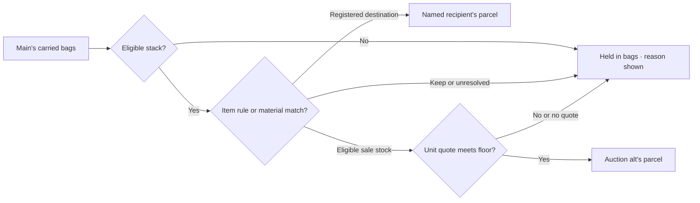
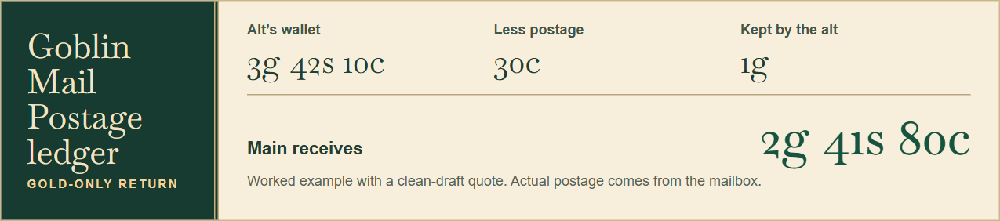

<h1></h1>

**[↓ Download ForeverGoblinMailer.zip](https://github.com/LML-Studio/ForeverGoblinMailer/releases/download/v2.0.0-preview.3/ForeverGoblinMailer.zip)** · [Release notes](https://github.com/LML-Studio/ForeverGoblinMailer/releases/tag/v2.0.0-preview.3) · [Verify your download](handbook/Release-integrity.md)

Send cloth to your tailor, dust to your enchanter and sale stock to your auction alt. The mail desk shows the name on every envelope and why each stack is going. Profession alts can send materials and spare gold home.

1. **Install.** With WoW closed, extract the `ForeverGoblinMailer` folder into `_forever_/Interface/AddOns/`. Enable it on the character screen. Upgrading from **Forever Mail Fix**? Disable its old folder. [Installation guide](handbook/Install-and-first-use.md)
2. **Register.** Type `/fgm` on each character. In **Address book**, pick **Main**, **Auction alt** or a profession. Choose **Register this character**, check the full name, then **Confirm assignment**.
3. **Mail.** On your main, open a mailbox and choose **Route my bags**. Check each recipient and the **Held in bags** list, then press **Send** with the displayed parcel count.

> [!IMPORTANT]
> An enrolled profession alt with a different registered main defaults to returning surplus gold **eight seconds after opening a mailbox**. **Cancel countdown** stops that visit. To change the default before visiting, type `/fgm` on the alt and open **Gold returns**. The alt keeps at least **1g after postage**.

 &nbsp; **Preview 3** · WoW Forever 1.60.1.71139 · Interface 16001 · Developed by **Mini II - Forever - PvE**

## Inside the mail desk

*Offline rendering of the actual addon with sample characters.* This review has two envelopes and three stacks. The bracers stay because they fail an eligibility check. Wool Cloth stays because the player gave it a **Keep** rule. Click an identified stack in the addon to inspect its rule.

**[Explore all six pages in the interactive tour →](https://lml-studio.github.io/ForeverGoblinMailer/#desk-tour)** · [Browse the illustrated handbook](handbook/Visual-mail-desk.md)

| At the mailbox | What you can see and do |
| --- | --- |
| [Mail desk](https://lml-studio.github.io/ForeverGoblinMailer/#tour-parcels) | Compare the recipients, quantities, routing reasons and every held stack. Choose **Auction stock only** for a separate seller run. |
| [Address book](https://lml-studio.github.io/ForeverGoblinMailer/#tour-addresses) | Read the detected realm and faction, plus every assigned or empty role. One character can take several professions on the same realm and faction. |
| [Routing rules](https://lml-studio.github.io/ForeverGoblinMailer/#tour-rules) | Inspect an item by ID or link. Send it to a specific profession, reserve it for the auction alt, or keep it in your bags. |
| [Gold returns](https://lml-studio.github.io/ForeverGoblinMailer/#tour-gold) | See your wallet, protected reserve and clean-draft postage. Set this alt’s delay and optional material return. |
| [Activity](https://lml-studio.github.io/ForeverGoblinMailer/#tour-activity) | See server receipts from this login or start an optional two-character delivery check. Check an uncertain delivery against the native draft and receiving inbox. |
| [Appearance](https://lml-studio.github.io/ForeverGoblinMailer/#tour-appearance) | Preview three finishes, three window sizes and two row spacings. Drag the header or dock the desk beside the mailbox. |

## Where the materials go

| Example | Default behavior |
| --- | --- |
| Linen Cloth or Strange Dust | Cloth follows Tailoring. Dust, essences and shards follow Enchanting. |
| Herbs, hides, ores and bars | Recognized families feed Alchemy, Leatherworking, Mining and Blacksmithing respectively. |
| A shared recipe ingredient | If the registered candidates resolve to one character, that character receives it. Otherwise the stack stays visible in the held list. |
| An eligible unbound sale item | Auctionator’s optional cached quote must reach the per-unit floor, initially **5g**. An explicit Auction rule works without a quote. |

The build indexes **589 ingredients and 1,084 ingredient–profession links**. An item-specific **Keep in bags** rule wins, including on returns. [Routing order, evidence and data provenance](handbook/How-the-addon-works.md)

## How much gold comes home?

The gold-only Send button requires a positive surplus. At a 1g reserve and a 30c quote, a 1g 0s 30c wallet offers no letter. One copper more offers a letter carrying **1c**. An unknown quote is shown separately.

Try the same balance with a **2g** reserve and the return drops to **1g 41s 80c**. In a material shipment each letter pays its own postage. Only the last can carry the remaining surplus. The addon checks the actual wallet and postage again before it sends. [Try the postage calculator](https://lml-studio.github.io/ForeverGoblinMailer/#preview) · [Configure this alt](handbook/Preferences-and-troubleshooting.md)

<strong>What if the draft changes or a delivery is uncertain?</strong>

The addon rechecks the recipient, physical item instance, variant, count, money, COD and native attachments. A submitted letter waits for `MAIL_SEND_SUCCESS` before the next parcel starts. If the outcome is unknown, inspect the native draft and receiving inbox, then reconcile the hold under **Activity**. [Queue and recovery diagram](handbook/How-the-addon-works.md#delivery-and-recovery)

<strong>How can I inspect the addon before installing it?</strong>

Download the named ZIP and checksum from the same release. Compare SHA-256 to confirm the bytes, then inspect the TOC and Lua for behavior. For a second opinion, share just the addon source with a reviewer or an AI and ask it to trace every path that selects a recipient, attaches items, sets money or sends mail. Ask for file and line references for unexpected addresses, chat transmission or hidden executable code. Read those paths yourself. Keep account settings and private logs out of the review. [Checksum and source-review guide](handbook/Release-integrity.md)

## Release and support

Preview 3 passed **50 Lua 5.1 scenarios** and was installed with a readback on Forever build 71139. Use `/fgm check` to record a controlled transfer locally and match the receiving inbox. The live acceptance record is tracked in [issue #5](https://github.com/LML-Studio/ForeverGoblinMailer/issues/5). [Verification record](handbook/Release-preview-3-checks.md) · [Known issues and scores](handbook/Testing-and-roadmap.md) · [File a bug](https://github.com/LML-Studio/ForeverGoblinMailer/issues/new?template=bug-report.yml)

[Player wiki](https://github.com/LML-Studio/ForeverGoblinMailer/wiki) · [Engineering PR for the addon](https://github.com/LML-Studio/ForeverGoblinMailer/pull/9) · [Original subject-prefill release](https://github.com/LML-Studio/ForeverGoblinMailer/releases/tag/v1.1.0)
