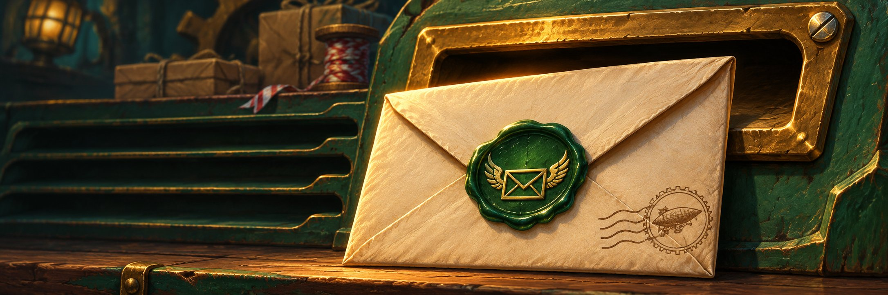
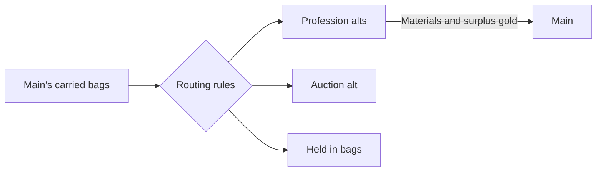

# Forever Goblin Mailer

Send cloth to your tailor, dust to your enchanter, auction stock to your seller, and surplus gold home. Open a mailbox to see what each character will receive.

**[⬇ Download the install ZIP](https://github.com/LML-Studio/ForeverGoblinMailer/releases/download/v2.0.0-preview.1/ForeverGoblinMailer.zip)** · [Release notes and SHA-256](https://github.com/LML-Studio/ForeverGoblinMailer/releases/tag/v2.0.0-preview.1) · [Interactive mailroom](https://lml-studio.github.io/ForeverGoblinMailer/)

1. **Install.** With WoW closed, extract the `ForeverGoblinMailer` folder into `_forever_/Interface/AddOns/`. If you used **Forever Mail Fix**, move its old addon folder out of AddOns or disable it on the character screen.
2. **Enroll.** On your main, type `/fgm`, choose **Main**, and click **Register** twice to confirm the displayed full name. Repeat on each profession alt and your auction alt. One character can hold several roles.
3. **Dispatch.** On the main, open a mailbox, choose **Route my bags**, review the named parcels, then click **Send reviewed parcels**. On an enrolled profession alt, opening the mailbox starts an **eight-second** gold return. **Stop** cancels it. **Setup → Include bag materials** puts materials on that automatic return too.

**Preview for WoW Forever 1.60.1.71091 · Interface 16001.** The Lua 5.1 suite exercises the send path with synthetic inventories. The first live delivery and native transfer confirmation remain open. [Native acceptance checklist](https://github.com/LML-Studio/ForeverGoblinMailer/issues/5)

 

## At the counter

| Mailbox action | Where | What happens |
| --- | --- | --- |
| **Route my bags** | Main | Groups profession ingredients and eligible auction stock by character. The manifest lists every included stack and every item held. |
| **Auction stock only** | Main | Prepares only the auction character’s parcel. Use **Auction** rules for specific items or set a cached market-price floor. |
| **Gold to main** | Profession alt | Previews a gold-only return. The amount uses the current balance and native postage, with **1g kept on the sender**. |
| **Materials to main** | Profession alt | Reviews transferable ingredients in carried bags. With automatic gold enabled, the last envelope also carries the surplus. Disable automatic gold for material-only returns. |
| **Setup / Stop** | Any enrolled character | Manage roles, item rules, auction floor and this alt’s return preferences. Stop cancels the countdown or any remaining parcels. |

## What goes where

| What you find | Default destination |
| --- | --- |
| Linen Cloth, Silk Cloth, Runecloth | Tailoring |
| Strange Dust, essences, shards | Enchanting |
| Raw herbs, hides, ores, bars | Alchemy, Leatherworking, Mining and Blacksmithing respectively for the recognized families |
| A Forever recipe ingredient | The profession that consumes it. A shared ingredient goes to a single qualifying address when the address book resolves it. Conflicts appear under **Held in bags**. |
| An eligible unbound miscellaneous item | The auction alt when Auctionator’s per-unit quote reaches the floor, initially **5g**. An explicit Auction rule works without Auctionator. |
| Something you always want to keep | An item-specific **Keep in bags** rule takes precedence, including on return trips. |

The ingredient index links **589 items to 1,084 profession uses** in the pinned Forever build. Familiar material families take precedence over overlapping recipes, so First Aid also using cloth does not redirect your tailor’s default supply. Use an item ID or link in Setup to change a route. [Recipe index and data provenance](handbook/How-the-addon-works.md)

## Where the gold goes

With **3g 42s 10c** on the alt and a **30c** postage quote, the main receives **2g 41s 80c** and the alt keeps **1g**. With several parcels, earlier envelopes pay their own postage. The last one can carry the gold that is left. If postage would take the alt below its reserve, the queue stops before submitting that parcel. [Gold and material return settings](handbook/Preferences-and-troubleshooting.md)

## Checking a delivery

The review records the recipient and each physical stack. Dispatch checks the bag slot, item instance, variant and count again, reads back the native attachments, and waits for `MAIL_SEND_SUCCESS` before the next envelope. A stopped or uncertain transfer shows a delivery hold. Inspect the native draft or the receiving inbox before clearing it. Blizzard owns any secure confirmation prompt. [Dispatch and recovery](handbook/How-the-addon-works.md)

## Install addons from a source you trust

Download the versioned ZIP above, compare its SHA-256 with the release checksum, and inspect the TOC and Lua files. The checksum confirms which published bytes you received. For a second opinion, give an AI reviewer **only the addon source** and ask, *“Trace every path that chooses a recipient, attaches an item, sets money or sends mail. What triggers it? Flag unexpected destinations, hidden code, chat transmission, or behavior outside the stated purpose. Cite each file and line.”* Review its evidence yourself. Keep account settings and personal logs private. [Integrity guide](handbook/Release-integrity.md)

## Project

Developed by **Mini II - Forever - PvE**. The original subject-prefill addon is archived in its [v1.1.0 release](https://github.com/LML-Studio/ForeverGoblinMailer/releases/tag/v1.1.0). Version 2 uses a new addon folder and settings owner.

[Player wiki](https://github.com/LML-Studio/ForeverGoblinMailer/wiki) · [Verification and open work](handbook/Testing-and-roadmap.md) · [Report a problem](https://github.com/LML-Studio/ForeverGoblinMailer/issues)
