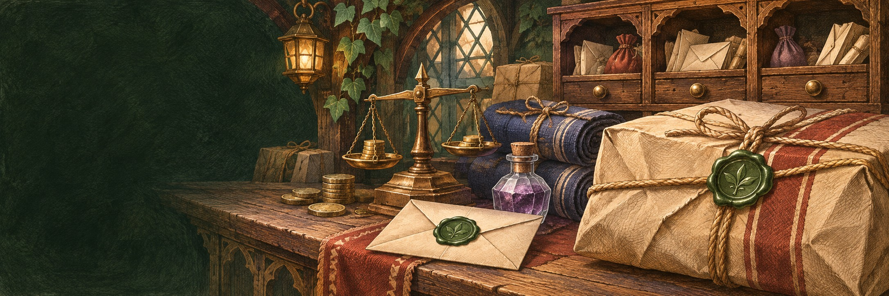

# Cover and typography

The postal counter illustration was created for Forever Mail Fix using the built-in ImageGen tool. The envelope, seal and workshop are original promotional art. The website uses the cover as an illustration of its mail theme. Screens and diagrams labeled as examples represent behavior rather than a capture of the game.

Cover art direction and generation prompt

Use case: stylized-concept. Asset type: wide horizontal editorial cover illustration for the GitHub repository of Forever Mail Fix, a tiny World of Warcraft Forever mail-subject addon. Create an original, premium in-world goblin postal stationery still life with cinematic, hand-crafted materials. Panoramic landscape aspect ratio about 3:1, full bleed. A single beautiful ivory envelope with an emerald wax seal bearing a simple invented winged-envelope relief leans against a worn brass post sorting slot in a dark teal enamel frame. One restrained ramshackle brass rivet detail and a fine postal-stamp engraving in the margin hint at a fantasy goblin workshop. Simple, decisive silhouette, large, readable even at 650px width. Scene balanced like a luxurious standard-edition game manual cover; deep pine-green, midnight-ink shadows, warm parcel-paper and aged gold, luminous edge light on the pale folded paper, fine tooth like engraved print, crisp macro details. Let the left side breathe with interesting horizontal grooves; primary envelope near center-right. No text at all, no slogans, no typography, no watermark, no Blizzard or real-world logos, no character portraits, no UI. Original illustration only; quiet and inviting.

The **Preview 2 handbook cover** uses a second original ImageGen illustration of the sorting counter, linen parcels, enchanting dust and brass postal scales. Its typesetting, the postage slip and the download page use the same pine, parchment and brass palette. The six desk illustrations are rendered from the actual addon frames with synthetic data. Client font and icon artwork shown within the interface belongs to its respective owners. These rendered examples contain no player screenshots or account records.

The Preview 3 address book, gold ledger, Activity page and paired zero/one-copper reviews were rendered from the Preview 3 Lua frame tree. They use the same client artwork as the earlier handbook and contain synthetic wallets, names and mail.

Baskervville is used for the landing page and printed documentation graphics. Copyright 2018 The Baskervville Project Authors. The unmodified variable font is distributed with its [SIL Open Font License](fonts/OFL.txt). [Upstream revision](https://github.com/google/fonts/tree/06bfe0d62a98375cb09c942fa18e68bd32cff057/ofl/baskervville)

**Addon developer — Mini II - Forever - PvE.**
