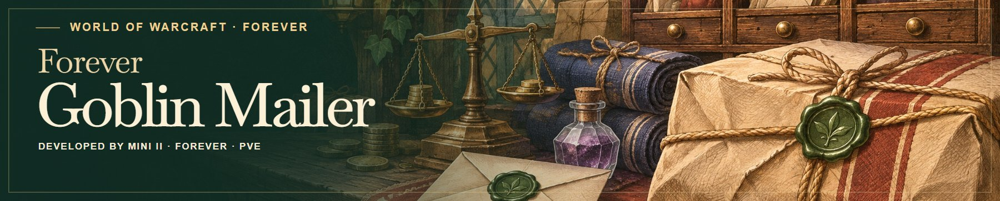

# Player handbook

**[Download the install ZIP](https://github.com/LML-Studio/ForeverGoblinMailer/releases/download/v2.0.0-preview.4/ForeverGoblinMailer.zip)** · [Install and first use](https://github.com/LML-Studio/ForeverGoblinMailer/wiki/Install-and-first-use) · [Explore the six desk pages](https://github.com/LML-Studio/ForeverGoblinMailer/wiki/Visual-mail-desk)

Put `ForeverGoblinMailer` in `_forever_/Interface/AddOns/` while WoW is closed. Register your main and alts with `/fgm`. **Mail network** shows the resolved realm name or ID and faction. At the mailbox on your main, choose **Route my bags**, read the recipients, and use the gold **Send** button when the manifest is right.

| What do you want to do? | Open this guide |
| --- | --- |
| Install the right folder or upgrade from the old subject fix | [Install and first use](https://github.com/LML-Studio/ForeverGoblinMailer/wiki/Install-and-first-use) |
| See what each button does before entering the game | [Visual mail desk](https://github.com/LML-Studio/ForeverGoblinMailer/wiki/Visual-mail-desk) |
| Assign shared materials, change the auction floor or stop an automatic return | [Preferences and troubleshooting](https://github.com/LML-Studio/ForeverGoblinMailer/wiki/Preferences-and-troubleshooting) |
| Follow a stack through the recipe index, recipient checks and mail queue | [How the addon works](https://github.com/LML-Studio/ForeverGoblinMailer/wiki/How-the-addon-works) |
| Check the ZIP or ask a reviewer to inspect the Lua | [Release integrity](https://github.com/LML-Studio/ForeverGoblinMailer/wiki/Release-integrity) |
| See what passed on Preview 4 and what still needs an in-game run | [Preview 4 verification](https://github.com/LML-Studio/ForeverGoblinMailer/wiki/Release-preview-4-checks) |
| Report a defect or compare its priority, value and complexity | [Testing and roadmap](https://github.com/LML-Studio/ForeverGoblinMailer/wiki/Testing-and-roadmap) |

**On your first profession-alt visit**, an eight-second gold draft is enabled by default once a different main is registered. Open **Gold returns** via `/fgm` before visiting if you want to change it. Check the filled gold, silver and copper fields and press **Send** in WoW. The alt keeps at least one gold after postage.

Developed by **Mini II - Forever - PvE**.
