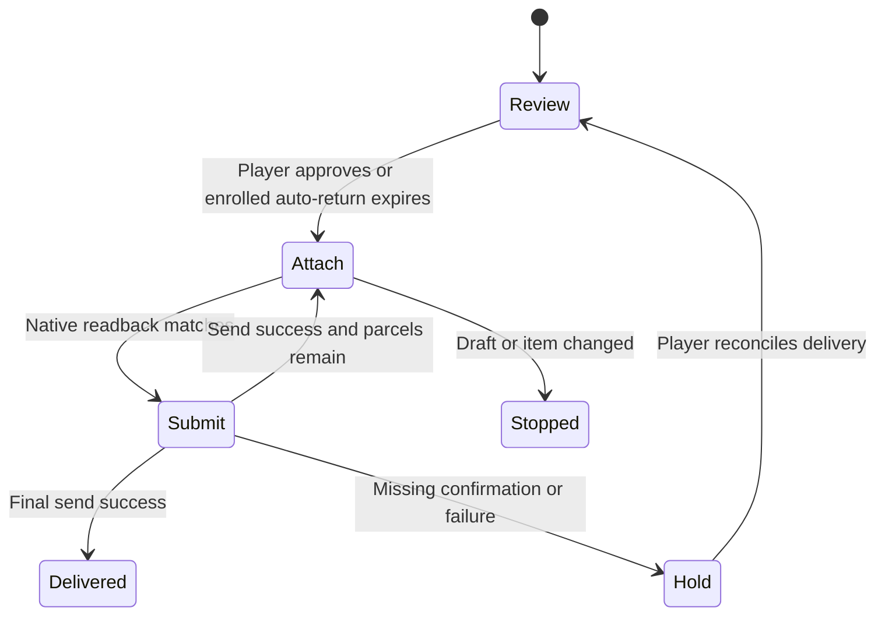

# How the addon works

## Identity and data

The address book is scoped by realm and faction. Registration binds a role to the logged-in character’s GUID and native full mailing name. Forever’s Camelot UI joins the first name and surname using the client’s separator. Both the registration control and the outgoing preview display that address. The only saved table is `ForeverGoblinMailerDB`. [Forever naming source](https://github.com/Gethe/wow-ui-source/blob/c01a87b549bbc19e0f284c1616d18654c91297de/Interface/AddOns/Blizzard_FrameXMLUtil/Camelot/NameUtil.lua)

The ingredient index joins `SkillLineAbility.Spell` to `SpellReagents.SpellID` for the profession skill lines. Only positive reagent IDs with a positive consumed count are admitted. The 1.60.1.71091 snapshot contains **589 distinct ingredients** and **1,084 ingredient–profession links**. The data came from the build’s three DB2 files and its matching enUS hotfix cache. The release carries numeric ingredient IDs and role names. Each bag scan uses client item metadata. [Generator](https://github.com/LML-Studio/ForeverGoblinMailer/blob/main/tools/build_recipes.py) · [Generated index](https://github.com/LML-Studio/ForeverGoblinMailer/blob/main/ForeverGoblinMailer/Recipes.lua)

| Decoded table | SHA-256 used for this build |
| --- | --- |
| SkillLine | `0a6fd95fa157cd0b3c1b00da55cad527d389398bcc6172e460459f6dcc94b7cd` |
| SkillLineAbility | `ff55ddaf9769371cab81898ca019196ea4c694e1d5148d216674112d3d4ebafd` |
| SpellReagents | `8c094f008ad07e72423713742add5e85a537b8baf9ef92c153e38d6d45588a06` |

## From bag to recipient

1. Read the backpack and equipped carried bags. Hold locked, bound, loot-containing, quest, refundable, equipment-set and unresolved stacks. Identify the physical slot, GUID, item variant and quantity.
2. Apply the player’s item rule. Familiar material families take priority, followed by recipe use. For a shared recipe ingredient, all registered candidates must point to one character to route automatically. A free choice remains visible in the held list.
3. For eligible remaining goods, obtain an optional Auctionator unit price and compare with the floor. The per-item Auction rule works independently.
4. Group by receiving character, in the order encountered, and split at the native attachment limit. Every included stack and excluded reason appears in the review.
5. At dispatch, require a clean draft. Re-read each reviewed bag slot immediately before attaching, then check the exact native recipient, subject, body, money, COD and attachment variant/count before submission.
6. Quote postage and check the balance again after populating the money field. Each client-accepted parcel reduces the run’s spending budget. A different quote, insufficient balance or mismatched stack stops the queue.

A single in-flight parcel waits for `MAIL_SEND_SUCCESS`. The more general `MAIL_SUCCESS` can accompany inbox operations. A 30-second timeout ends the queue and leaves a delivery hold. WoW saves the hold with normal SavedVariables writes. Blizzard owns any secure confirmation dialog. [Native mail frame](https://github.com/Gethe/wow-ui-source/blob/c01a87b549bbc19e0f284c1616d18654c91297de/Interface/AddOns/Blizzard_MailFrame/MailFrame.lua) · [Mail events](https://github.com/Gethe/wow-ui-source/blob/c01a87b549bbc19e0f284c1616d18654c91297de/Interface/AddOns/Blizzard_APIDocumentationGenerated/MailInfoDocumentation.lua) · [Secure transfer API](https://github.com/Gethe/wow-ui-source/blob/c01a87b549bbc19e0f284c1616d18654c91297de/Interface/AddOns/Blizzard_APIDocumentationGenerated/SecureTransferDocumentation.lua)

## Runtime layout

| File | Responsibility |
| --- | --- |
| Roster.lua | Scope, names, character roles and the auction floor |
| Recipes.lua | Generated profession-ingredient membership |
| Routing.lua | Precedence, material families, parcel grouping and money arithmetic |
| Mailbox.lua | Read the native bags, cursor, compose fields, attachment list and postage |
| Dispatch.lua | Countdown, review, guarded execution, acknowledgement and recovery |
| Panel.lua | Mailbox launcher, scrollable manifest, settings and slash commands |
