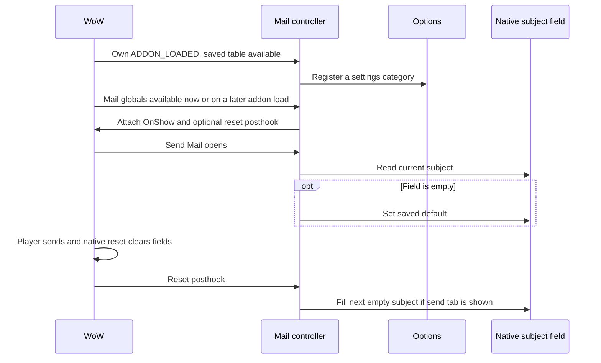

# How the addon works

The manifest loads the mail controller and then the options code into a shared addon namespace. `ForeverMailFixDB` is an account-wide SavedVariable. At the addon's own `ADDON_LOADED` event the controller validates that the saved owner is a table and that its subject contains a non-whitespace byte under Lua's pattern rules. Invalid values use the original default. See [the Unicode edge case](https://github.com/TLDUBE/ForeverMailFix/issues/2).

### Deferred initialization

On each relevant addon-load opportunity after its own initialization, the controller asks the options module to register its native canvas category. A legacy Interface Options registration route is available as a fallback. The mail hook installer checks the actual send frame and subject field. Both installers remember success. After both have succeeded, the event listener unregisters. The addon uses no polling loop or periodic update.

### One edit, three entry points

The same fill function runs on send-panel show, after the native reset helper where available, and when saving a new default. The implementation checks the send frame's local shown flag and requires the subject to equal the empty string. Existing text, including a reply subject, is preserved. If a parent is hidden while the child remains locally shown, the visibility test can still pass. [Visibility finding](https://github.com/TLDUBE/ForeverMailFix/issues/1)

The successful-send path is a posthook so the call comes **after** Blizzard clears the field. An independent send-success event listener could otherwise run first and have its text cleared immediately. An absent reset helper still permits first-open prefilling.

### Data and interaction boundaries

| Surface | Owner and behavior |
| --- | --- |
| Account default | `ForeverMailFixDB.subject`, written by the options callback and persisted by WoW. |
| Mail subject | Blizzard's native edit box; the addon sets an empty field to the default. |
| Send, recipient, inventory and money | The native client owns these controls throughout the transaction. |
| Options | One native panel with a single-line input, Save, Restore Default, status text and a visible developer credit. |
| Unload | On a later game load with the addon disabled, its Lua and hooks are absent. |

[Manifest](https://github.com/TLDUBE/ForeverMailFix/blob/v1.1.0/ForeverMailFix/ForeverMailFix.toc) · [Mail controller](https://github.com/TLDUBE/ForeverMailFix/blob/v1.1.0/ForeverMailFix/ForeverMailFix.lua) · [Options module](https://github.com/TLDUBE/ForeverMailFix/blob/v1.1.0/ForeverMailFix/Options.lua) · [Verification](Testing-and-roadmap.md)
