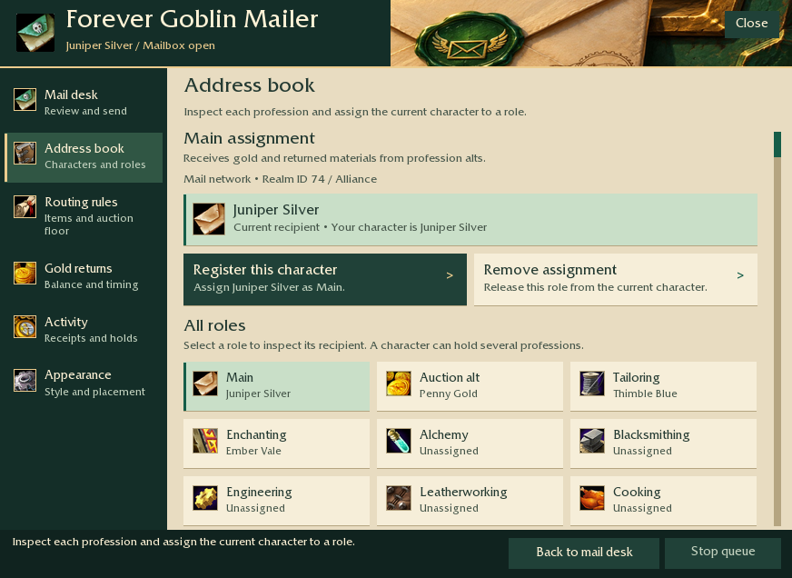

# Install and first use

**[Download ForeverGoblinMailer.zip](https://github.com/LML-Studio/ForeverGoblinMailer/releases/download/v2.0.0-preview.3/ForeverGoblinMailer.zip)** · [Checksum and release](https://github.com/LML-Studio/ForeverGoblinMailer/releases/tag/v2.0.0-preview.3)

1. Close WoW before changing addon files. Extract the ZIP into the Forever client's `_forever_/Interface/AddOns/` directory. Check that `AddOns/ForeverGoblinMailer/ForeverGoblinMailer.toc` exists. A second nested folder prevents discovery.
2. If upgrading from **Forever Mail Fix**, disable the old addon on the character screen or move its folder outside AddOns while the game is closed. The old subject preference belongs to v1. Version 2 starts with an empty address book.
3. Enable **Forever Goblin Mailer** in AddOns. Use `/fgm` or **Goblin Mailer → Address book**. On your main choose **Main**. Check the full native name and choose **Register this character**, then **Confirm assignment**.
4. Log into the relevant alts. Register the tailor for **Tailoring**, the enchanter for **Enchanting**, and the auction character for **Auction alt**. A character with two jobs can register both. The address book is shared within the same realm and faction. Re-register after a character name change.
5. On the main, open a mailbox. Choose **Route my bags** and scroll through every named parcel and held stack. Select the gold **Send** button that shows the parcel count. Start with a low-value stack for your first delivery.

## What a correct installation looks like

```text
_forever_/
└── Interface/
    └── AddOns/
        └── ForeverGoblinMailer/
            ├── ForeverGoblinMailer.toc
            ├── Roster.lua
            ├── … seven other Lua files …
            ├── Panel.lua
            └── Mailroom.tga
```

In **Address book**, every profession shows its recipient or **Unassigned**. Check the native full name before confirming a replacement.



*Offline example with sample characters.* Players upgrading from Preview 1 or 2 keep their role assignments, item overrides and per-alt settings when they replace the addon folder with Preview 3. The v1 subject-prefill addon uses a different settings table.

**Mail network** shows your realm name or numeric realm ID and faction. Two characters on the same network share role assignments. Missing names can resolve to a public ID. If the client identity is still loading, the open panel retries on player identity events.

## The first visit on a profession alt

When a different main is registered, a profession alt gets a gold-return countdown (eight seconds by default) on mailbox open. **Cancel countdown**, selecting a review, or browsing a settings page cancels it for that visit. To disable automatic gold before visiting a mailbox, type `/fgm` on that alt and open **Gold returns** and toggle **Automatic gold** off. To opt into material returns on every visit, enable **Include materials** under **Gold returns** on that alt.

An auction-only character receives stock. Registering it as a profession alt as well makes it eligible for that profession’s gold-return behavior. [Configure routing](https://github.com/LML-Studio/ForeverGoblinMailer/wiki/Preferences-and-troubleshooting)
