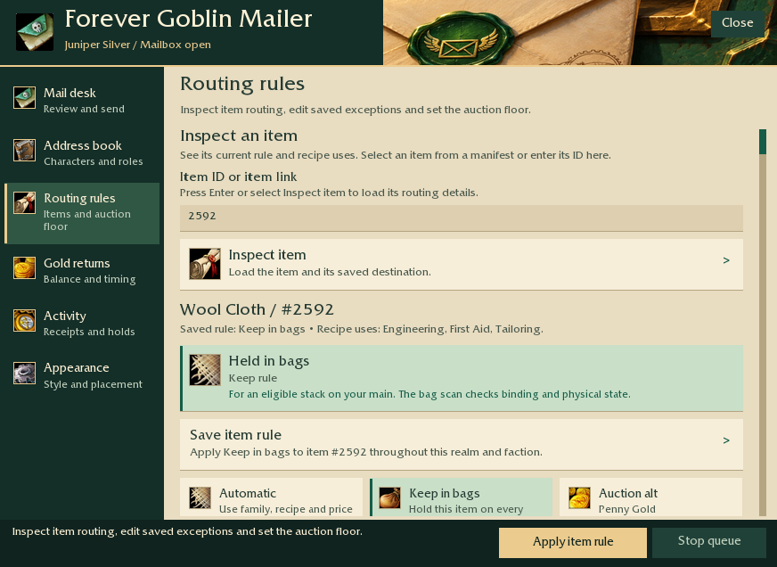
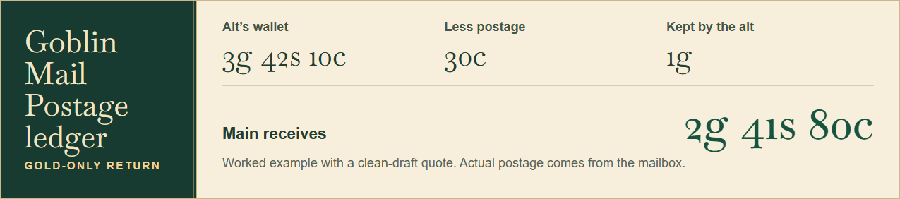

# Preferences and troubleshooting

## Address book and item rules

Use **Address book** on the character you are enrolling. The name comes from Forever’s full-name helper and includes the native surname separator. Enrolling again updates the selected role. **Remove assignment**, followed by **Confirm removal**, releases a role held by the current character. The Mail desk page shows all enrolled destinations.

For shared ingredients, paste an item link or enter a numeric item ID in **Routing rules** and choose **Inspect item**, select a profession, **Auction alt**, or **Keep in bags**, then **Apply item rule**. Choose **Automatic** to remove that override. Rules apply to all matching item IDs on the same realm and faction. One character can own more than one profession. An item already on its destination character stays there.

*Offline example.* This **Keep in bags** rule takes Wool Cloth out of Tailoring shipments. Select **Automatic** and **Apply item rule** to restore the material route.

## Auction stock

The default floor is **5 gold per unit**. Change it under **Routing rules → Minimum gold per unit**. Auctionator supplies an optional cached item-link quote for eligible weapons, armor, recipes and miscellaneous items. A stack of twenty items valued at 30s each stays under a 5g per-unit floor. A missing quote holds the item. For a specific collectible or item outside those groups, set an explicit Auction rule. Check your market before mailing stock. [Quote-age tracking](https://github.com/LML-Studio/ForeverGoblinMailer/issues/6)

## Gold and optional material returns

| Alt setting | Opening a mailbox | Choosing Materials to main |
| --- | --- | --- |
| Automatic gold on, materials off | Gold only after the configured countdown | Reviewed materials with surplus on the final letter |
| Automatic gold on, materials on | Materials and surplus after the configured countdown | The same batch can be reviewed first |
| Automatic gold off | Waits for a mailbox action | Reviewed materials only. **Gold to main** is available separately. |

**Gold returns** shows this character’s wallet, protected reserve, empty-draft postage and gold-only return when a clean native quote is available. Set the delay to **8, 15 or 30 seconds**. Save any whole-gold reserve from **1g** up to **1,000,000g**. The selected reserve also applies to postage on material-only letters. At exactly the reserve there is no postage available for another parcel. If you plan to send materials, combine them with the gold trip, or choose **Materials to main** during the countdown. **Keep** and explicit **Auction** rules are respected on the return. Gold-only mail will send the surplus after actual postage.

[Try your own balance and reserve](https://lml-studio.github.io/ForeverGoblinMailer/#preview). Gold-only review shows **No gold to send** for a known zero and **Quote unavailable** for a missing quote. A positive surplus of 1c is sufficient. Each real material letter can still leave with zero gold when its postage is covered. [Gold review fix](https://github.com/LML-Studio/ForeverGoblinMailer/issues/10)

## What to do when a parcel stops

| Panel message or symptom | What to check |
| --- | --- |
| Waiting for realm identity | Inspect **Address book → Mail network**. A numeric ID is a valid Forever network. When all public identity sources are unavailable, retry after login or leaving combat. |
| No active route buttons | Check your current character’s role, enrolled main, realm and faction. Wait until combat ends and reopen the mailbox. |
| No address / choose a profession rule | Enroll the destination on that character, or assign the shared material by item ID. |
| Item data pending | Wait for the tooltip to load and run the review again. |
| Current draft is in use | Finish or clear your own draft. A reply, COD, money, cursor item or existing attachment prevents starting. |
| Stack changed or pickup refused | Check the bag slot, cursor and native draft. Rebuild the review after clearing the draft. |
| Insufficient postage | Add funds or reduce the shipment. The sender keeps at least one gold on every profession-alt parcel. |
| Unconfirmed send | Inspect the original sender, native draft and recipient inbox. Allow for delivery delay. Only after reconciling the parcel, use **Activity → Clear delivery hold → Confirm checked delivery** and start a fresh review. |

Closing the mailbox or entering combat cancels the remaining queue. Native attachments already moved to a draft may still be present. A server-accepted parcel is already on its way.

## Reading the desk

Each profession row shows the enrolled native name or its unassigned state. Dispatch cards explain the action and why it might be unavailable. A manifest item shows its quantity, routing basis and destination. Select it to open that item’s rule. The held section gives the reason for each excluded stack. Changes to mail rules require a fresh review.

Use **Appearance** to preview three finishes, switch between comfortable and compact rows, or set window size to 85%, 100% or 115%. Drag the illustrated header to save a floating position. **Dock beside mailbox** restores automatic placement. Presentation choices are account-wide. Gold choices belong to the current character. The desk scales down to fit small screens.
