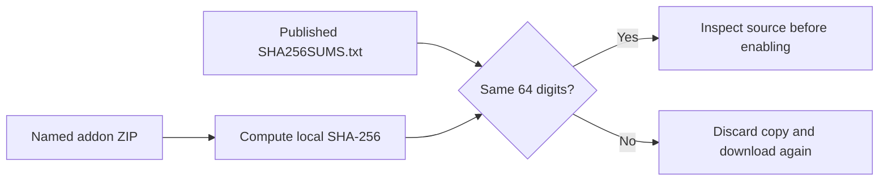

# Release integrity

Download **[ForeverGoblinMailer.zip](https://github.com/LML-Studio/ForeverGoblinMailer/releases/download/v2.0.0-preview.3/ForeverGoblinMailer.zip)** and **[SHA256SUMS.txt](https://github.com/LML-Studio/ForeverGoblinMailer/releases/download/v2.0.0-preview.3/SHA256SUMS.txt)** from the same release. On Windows, run the following in the download directory.

```powershell
Get-FileHash -Algorithm SHA256 -LiteralPath .\ForeverGoblinMailer.zip
Get-Content -LiteralPath .\SHA256SUMS.txt
```

Compare all 64 hexadecimal digits. A match identifies the published archive. Inspect its contents to assess trust. This ZIP contains one TOC, nine Lua files and one uncompressed TGA header illustration under a single `ForeverGoblinMailer` folder. You can read every file before enabling it. [Tagged source](https://github.com/LML-Studio/ForeverGoblinMailer/tree/v2.0.0-preview.3/ForeverGoblinMailer)

## What the checksum verifies



Preview 3’s ZIP fingerprint is `23367a9530f808ede009750d312a08639e57216da0fd328f662a98fbbdce7e4f`. A match confirms identity with the published archive. Review the publisher and source to assess what the addon can do. [Verification record](https://github.com/LML-Studio/ForeverGoblinMailer/wiki/Release-preview-3-checks)

## What the optional delivery check records

Starting `/fgm check` adds a short test marker to outgoing subjects. For up to eight parcels over two hours, it saves the expected sender, recipient identifier, item quantities, gold and postage within the realm/faction settings. Loaded inbox entries are compared locally to the full marker, sender and contents. It never takes or opens an item. Starting another check after ending the first replaces its records. Keep saved settings private when sharing reports.

## A second pair of eyes

Share only the addon source with a reviewer or an AI you trust. Ask it to trace **how recipients, items and money are selected**, which events can start a send, how confirmation is handled, and whether the code sends chat messages, evaluates hidden code or accesses unrelated saved data. Ask for file and line references. Compare its findings with the source. An automated review can miss behavior. Account folders, private logs, saved settings and authentication details are unnecessary for this review.

Maintainers can run `python tools/verify_package.py` to compare the bytes in the archive with the repository source. `python tools/verify_package.py --build` rebuilds the deterministic archive. The release contains the actual addon ZIP as a named asset. GitHub's generic source archives contain the entire development project.
