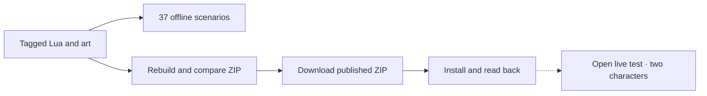
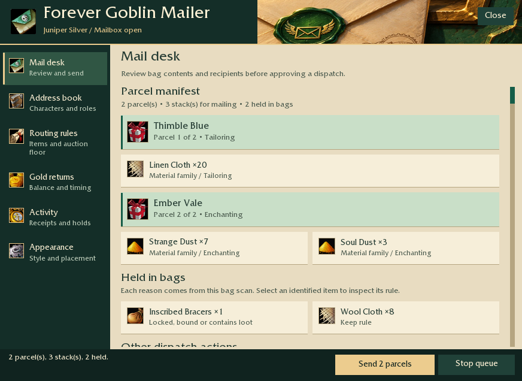

# Preview 2 verification

**[Download the verified ZIP](https://github.com/LML-Studio/ForeverGoblinMailer/releases/download/v2.0.0-preview.2/ForeverGoblinMailer.zip)** · [Release notes](https://github.com/LML-Studio/ForeverGoblinMailer/releases/tag/v2.0.0-preview.2) · [Engineering PR #9](https://github.com/LML-Studio/ForeverGoblinMailer/pull/9)

| Record | Verified result |
| --- | --- |
| Build and source | WoW Forever 1.60.1.71091, Interface 16001. [Runtime tag](https://github.com/LML-Studio/ForeverGoblinMailer/tree/v2.0.0-preview.2/ForeverGoblinMailer) at `2b4b6b1`. |
| Automated behavior | 37 Lua 5.1 scenarios passed. Synthetic bags, wallet, receipts and timers exercise the actual routing, dispatcher and frame handlers. [Passing CI run](https://github.com/LML-Studio/ForeverGoblinMailer/actions/runs/45669351683) · [Test suite](https://github.com/LML-Studio/ForeverGoblinMailer/blob/v2.0.0-preview.2/tests/run.lua) |
| Published archive | **324,568 bytes**, ten files, one top-level addon folder. The anonymously downloaded ZIP matched the source-verified package and published checksum. [SHA-256](https://github.com/LML-Studio/ForeverGoblinMailer/releases/download/v2.0.0-preview.2/SHA256SUMS.txt) |
| Local installation | On November 25, 2026 the installer checked that WoW was closed, backed up the previous addon and read back the ten installed files on build 71091. The upgrade and rollback had also been rehearsed separately. |
| Live client | First-person visual acceptance, a real delivery to an enrolled surname, native confirmation behavior and balances at both ends still need a controlled two-character run. [Native checklist](https://github.com/LML-Studio/ForeverGoblinMailer/issues/5) |



## What the visual evidence shows



The fixture uses the Forever font and item icons with sample characters and inventory. It lets us inspect layout, routing labels and control states. A server acknowledgement, delivery to the receiving inbox and the actual secure prompt require observation in the running game. [Six-screen guide](https://github.com/LML-Studio/ForeverGoblinMailer/wiki/Visual-mail-desk)

## Recheck the same bytes

```text
1cafa7f72038281061ad091b1dd1366dcb392947106de73e5bc56de558507b61
```

In a checkout of the release tag, run `lua5.1 tests/run.lua` and `python tools/verify_package.py`. The [integrity guide](https://github.com/LML-Studio/ForeverGoblinMailer/wiki/Release-integrity) explains how players can perform the checksum comparison from the released ZIP alone.
