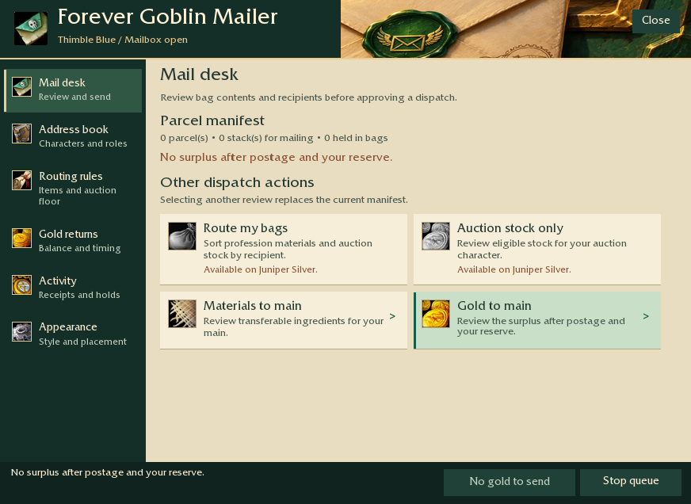
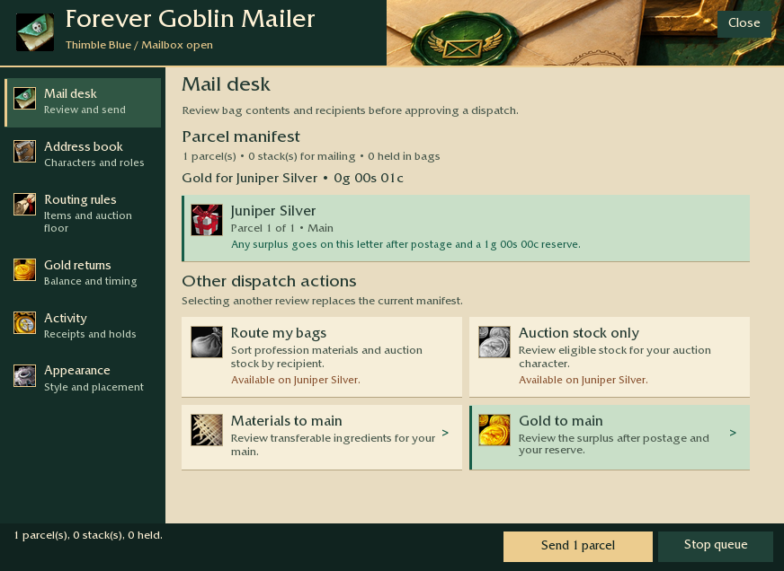
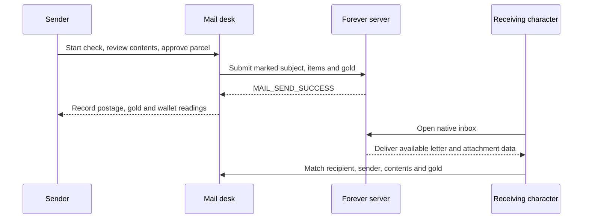

# Preview 3 verification

**[Download ForeverGoblinMailer.zip](https://github.com/LML-Studio/ForeverGoblinMailer/releases/download/v2.0.0-preview.3/ForeverGoblinMailer.zip)** · [Install the folder](https://github.com/LML-Studio/ForeverGoblinMailer/wiki/Install-and-first-use) · [Published checksum](https://github.com/LML-Studio/ForeverGoblinMailer/releases/download/v2.0.0-preview.3/SHA256SUMS.txt)

Preview 3 repairs the gold-only **Send** action and lets the address book open when Forever supplies a realm ID without a display name. It also adds an optional way to follow a parcel from the sender’s wallet to the receiving inbox. Developed by **Mini II - Forever - PvE**.

| Release record | Evidence |
| --- | --- |
| Client and package | WoW Forever **1.60.1.71139**, Interface **16001**. The ZIP is **328,331 bytes** and contains one addon folder with nine Lua files, a TOC and the mailroom illustration. [Runtime source](https://github.com/LML-Studio/ForeverGoblinMailer/blob/v2.0.0-preview.3/ForeverGoblinMailer) |
| Automated checks | **50 Lua 5.1 scenarios** exercise the actual roster, routing, dispatcher, mailbox adapter and desk controls using synthetic game state. [Scenarios](https://github.com/LML-Studio/ForeverGoblinMailer/blob/v2.0.0-preview.3/tests/run.lua) · [CI](https://github.com/LML-Studio/ForeverGoblinMailer/actions/workflows/verify.yml) |
| Installation | Upgrade and rollback were rehearsed. All eleven installed files were read back on build 71139 and matched the frozen package. The game’s SavedVariables are kept outside the addon folder. |
| Archive fingerprint | `23367a9530f808ede009750d312a08639e57216da0fd328f662a98fbbdce7e4f` |
| Live transfer | The checklist and dated observations are tracked in [issue #5](https://github.com/LML-Studio/ForeverGoblinMailer/issues/5). Use that record for actual delivery, wallet outcomes and native prompts. |

## The one-copper boundary

Gold-only review uses integer copper. The sample postage below is **30c**. The addon reads the price from the native draft for each real send.

| Alt’s wallet | Protected reserve | Native postage | Gold-only review | Observed in the fixture |
| ---: | ---: | ---: | --- | --- |
| 1g 00s 00c | 1g | 30c | **No gold to send** | Zero letters |
| 1g 00s 30c | 1g | 30c | **No gold to send** | Zero letters |
| **1g 00s 31c** | **1g** | **30c** | **Send 1 parcel** | Main receives **1c**, sender pays **30c**, wallet ends at **1g** |
| 2g 00s 30c | 2g | 30c | **No gold to send** | The higher reserve is protected |
| Available balance, unavailable postage | Any | Unknown | **Quote unavailable** | Send stays disabled until the clean draft supplies a quote |

| Exactly the reserve plus postage | One additional copper |
| --- | --- |
|  |  |

The same threshold governs an automatic return and a material review that finds nothing to attach. A real material parcel may still go when the alt can pay postage and keep the reserve, even with zero gold enclosed. A wallet or postage change refreshes an open gold review. If the amount changes at approval time, the desk asks for a fresh approval. [Gold review regression](https://github.com/LML-Studio/ForeverGoblinMailer/issues/10) · [Try the interactive calculator](https://lml-studio.github.io/ForeverGoblinMailer/#preview)

## Recovering a mail network

Open **Address book** and read **Mail network** under the selected assignment. A realm name or **Realm ID** followed by the faction identifies the active address book. Forever’s numeric realm APIs and the server component of a valid player GUID provide alternatives while a display name is unavailable. The addon reuses an existing book only when it can identify one matching network. This preserves its roles, rules, reserves and pending holds. If identity is still loading, the desk retries when the player’s identity updates. [Realm report](https://github.com/LML-Studio/ForeverGoblinMailer/issues/12) · [Client source for realm and faction](https://github.com/Gethe/wow-ui-source/blob/d9c22e32cb240afb82bb2ecefbb78ef935333f59/Interface/AddOns/Blizzard_FriendsFrame/Camelot/FriendsFrame.lua#L386)

## Check a live transfer

1. Register your main and one profession alt on the same mail network. On the alt, use **Gold returns** to turn **Automatic gold** off before visiting the mailbox for the first manual test.
2. On the main, use `/fgm check` or **Activity → Start delivery check**. Review **Route my bags**. Approve only the intended low-value stack and its displayed recipient. Starting the check itself sends nothing.
3. On the recipient, open the mailbox and let the inbox populate **before collecting the letter**. **Activity** shows marked, server-accepted and inbox-matched counts. The match compares the sender, recipient identity, marked subject, enclosed money and individual attachment IDs and quantities. The record stays in the addon’s local saved data through character changes.
4. On the alt, save a comfortable reserve. Review **Gold to main**, approve the amount you intend to send, then open the main’s inbox before collecting. Check that `starting wallet − postage − enclosed gold = ending wallet`.
5. To complete the full native checklist, repeat at a higher reserve. For a multi-letter return, use enough inexpensive stacks to exceed the client’s attachment limit, check the postage for each letter and the gold on the final one. Also cancel one countdown and close a separate unsent review. Record any native confirmation that appears and how the buttons and text fit at your UI scale. [Full acceptance criteria](https://github.com/LML-Studio/ForeverGoblinMailer/issues/5)

Each recording marks up to eight normal outgoing parcels over two hours. **End delivery check** stops marking new letters. Previously marked letters can still match on the recipient. Opening a fresh check after the previous one ends replaces its record. The player controls the native mail prompts and the collection of each letter. A character switch, reload or logout saves the local observations. [Delivery-check source](https://github.com/LML-Studio/ForeverGoblinMailer/blob/v2.0.0-preview.3/ForeverGoblinMailer/DeliveryCheck.lua)

[Previous release’s verification](https://github.com/LML-Studio/ForeverGoblinMailer/wiki/Release-preview-2-checks) · [Player handbook](https://github.com/LML-Studio/ForeverGoblinMailer/wiki)
