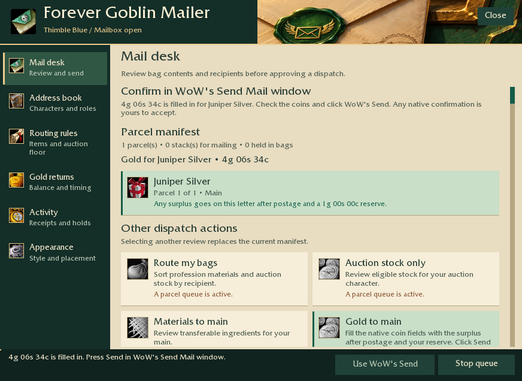
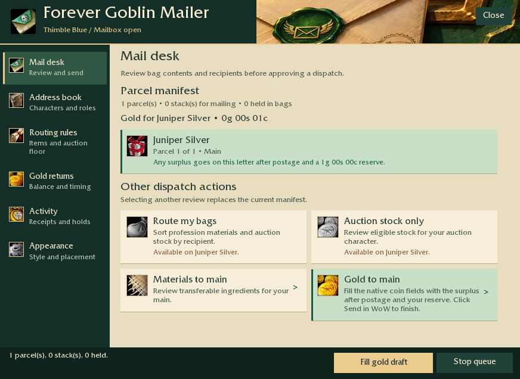
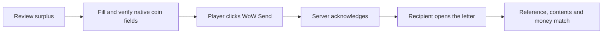

# Preview 4 · Native gold drafts

**[Download ForeverGoblinMailer.zip](https://github.com/LML-Studio/ForeverGoblinMailer/releases/download/v2.0.0-preview.4/ForeverGoblinMailer.zip)** · [Installation](https://github.com/LML-Studio/ForeverGoblinMailer/wiki/Install-and-first-use) · [Checksum](https://github.com/LML-Studio/ForeverGoblinMailer/releases/download/v2.0.0-preview.4/SHA256SUMS.txt)

On your profession alt, choose **Gold to main → Fill gold draft**. Check the recipient, subject and all three coins in WoW’s **Send Mail** tab. Press its **Send** button and handle any confirmation from Forever. The timed return prepares the same form. Items-only parcels still use the mailer’s queue.

*Example rendered from the addon with sample characters.* The reviewed amount is 4g 06s 34c. No money moves while the draft waits for the player's click.

## What arrives in the inbox

| Contents | Subject |
| --- | --- |
| Gold only | **Goblin Mail - Daily Interests** |
| Crafting materials returned to the main | **Goblin Mail - Materials for Main** |
| Materials for one profession | **Goblin Mail - Tailoring Supplies**, for example |
| Mixed profession supplies for the same character | **Goblin Mail - Profession Supplies** |
| Auction stock | **Goblin Mail - Auction Stock** |

Everyday letters have an empty body. An optional delivery check places one reference in the body so two letters can share the same title. The desk continues to show parcel counts during a batch.

## The first copper

| Wallet | Reserve | Sample postage | Gold fields and outcome |
| ---: | ---: | ---: | --- |
| 1g 00s 30c | 1g | 30c | No gold to send. Zero letters. |
| **1g 00s 31c** | **1g** | **30c** | **0g, 0s, 1c** appear in the form. After the simulated player clicks native Send, one letter carries **1c** and the wallet ends at **1g**. |
| 5g 06s 64c | 1g | 30c | The form contains **4g, 6s, 34c**. The fixture checks each field and reconciles the sender’s final wallet at **1g**. |
| 1g 00s 30c and one eligible stack | 1g | 30c | A material-only letter can send with **0c** enclosed. |

The amount is rechecked against native postage and the protected reserve while the addon owns the prepared draft. A wallet change that makes it unaffordable clears the addon’s amount. **Stop queue** cancels a draft the addon still owns. Editing a draft yourself transfers responsibility for the edited letter to you. [Native send code](https://github.com/Gethe/wow-ui-source/blob/d9c22e32cb240afb82bb2ecefbb78ef935333f59/Interface/AddOns/Blizzard_MailFrame/MailFrame.lua#L1256) · [Field report](https://github.com/LML-Studio/ForeverGoblinMailer/issues/14)

## Check a live transfer

1. Enroll both characters on the same network. Use `/fgm check` on the sender and review the intended recipient and contents.
2. Send an inexpensive material parcel or use **Fill gold draft** and WoW’s **Send**. Check the actual native recipient and coins. The countdown alone prepares a positive-money draft.
3. On the recipient, **open that specific letter before collecting**. The observer compares its reference, subject, sender, recipient identity, gold, COD and every stack’s item ID and quantity. For a Preview 3 letter with a tagged subject, opening the receiving inbox is sufficient.
4. Compare the sender’s before/after wallet, enclosed gold and native postage. **Activity** shows the server acknowledgement and inbox match separately. A normal logout or `/reload` saves the local result.

## Reproduce the release checks

- Run `lua5.1 tests/run.lua` for **56** isolated scenarios. Coverage includes player-owned Send, no automatic double submission, the three individual coin boxes, a full wallet debit at 1c, reserve drift, draft cancellation, all subject families and duplicate subjects with distinct references. [Tests](https://github.com/LML-Studio/ForeverGoblinMailer/blob/v2.0.0-preview.4/tests/run.lua)
- Run `python tools/verify_package.py` and `python tools/verify_docs.py` to verify the install ZIP, TOC, illustrations, links and current download. The package contains **11 files** and **330,091 bytes**. SHA-256 `28ac14be0efa9eb82827ffad6c8cccc3e22710751514f73b61fd034496b87172`.
- On Forever **1.60.1.71139**, the Preview 3 field run confirmed saved registrations using a numeric realm with the display name absent. A 12-stack material-only parcel received a server acknowledgement and its observed postage debit. The player reported empty native coins on a later gold attempt, prompting this release. Follow the active record for Preview 4 native results. [Live acceptance](https://github.com/LML-Studio/ForeverGoblinMailer/issues/5) · [Preview 3 evidence](https://github.com/LML-Studio/ForeverGoblinMailer/wiki/Release-preview-3-checks)

Developed by **Mini II - Forever - PvE**.
