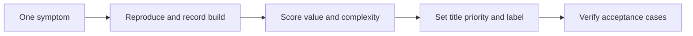

# Testing and roadmap

## Reproduce the release checks

From the tagged checkout run `lua5.1 tests/run.lua` and `python tools/verify_package.py`. The project also runs `python tools/verify_docs.py` to catch missing image assets, stale ZIP links and broken tour anchors. The current workflow runs all three checks. The 50 scenarios include numeric realm recovery, legacy scope isolation, zero/one-copper boundaries, cross-character delivery checks, every page, unavailable action tooltips, receipt reconciliation, preserved reserves, adjustable countdowns, and small-screen fitting. Offline snapshots run the real Lua frame tree with the build’s font and icons. The fixture supplies synthetic character identities, wallet balances, bags, cursor contents, native compose controls and timed server responses. [CI runs](https://github.com/LML-Studio/ForeverGoblinMailer/actions/workflows/verify.yml) · [Test scenarios](https://github.com/LML-Studio/ForeverGoblinMailer/blob/main/tests/run.lua)

| Covered offline | Native acceptance still needed |
| --- | --- |
| Full-name enrollment, realm/faction scoping, shared roles, self-mail prevention | Actual surname address delivery between two enrolled characters |
| Recipe graph, overrides, uncached items, per-unit auction floor and missing quotes | Actual Forever bag metadata and cached Auctionator prices |
| Stack identity, attachment readback, multi-parcel limits, draft/COD interference | Real clicks, cursor behavior, server pacing and secure transfer dialogs |
| One-gold boundary, changed final postage, lower live balance, cancellations and timeout holds | Before/after balances and inventory receipts on both actual characters |
| Mailbox launcher, review/send controls and slash settings in a fixture | In-game panel fit, input, scale and coexistence with other mailbox addons |

## Open work

| Priority | Report | Evidence | Player value | Fix complexity | Weighted |
| --- | --- | --- | --- | --- | --- |
| **P1** | [#5 · Deliver a real parcel and reconcile both wallets](https://github.com/LML-Studio/ForeverGoblinMailer/issues/5) | Native acceptance gate | 5/5 | 2/5 | **14/15** |
| **P2** | [#6 · Show the age of cached auction prices](https://github.com/LML-Studio/ForeverGoblinMailer/issues/6) | Price adapter exposes no timestamp | 4/5 | 3/5 | **11/15** |
| **P2** | [#7 · Offer a refresh when item details arrive](https://github.com/LML-Studio/ForeverGoblinMailer/issues/7) | Cold-data fixture | 3/5 | 2/5 | **10/15** |

[File a bug](https://github.com/LML-Studio/ForeverGoblinMailer/issues/new?template=bug-report.yml) · [All issues](https://github.com/LML-Studio/ForeverGoblinMailer/issues) · [Preview 3 verification](https://github.com/LML-Studio/ForeverGoblinMailer/wiki/Release-preview-3-checks)

## Fixed in Preview 3

- [#10 · Zero-surplus gold review](https://github.com/LML-Studio/ForeverGoblinMailer/issues/10) now requires at least 1c after the reserve and postage.
- [#12 · Realm-name-only lockout](https://github.com/LML-Studio/ForeverGoblinMailer/issues/12) now resolves the native realm ID and preserves unambiguous legacy networks.

## How we score reports

**Weighted score = 2 × player value + (6 − fix complexity).** Both inputs range from 1 to 5, following the [original bug reports](https://github.com/LML-Studio/ForeverGoblinMailer/issues/1). Titles and labels use **P1 for 14–15**, **P2 for 10–13**, and **P3 for 3–9**.

| Score | Player value of resolving it | Complexity of the fix or verification |
| --- | --- | --- |
| 1 | Cosmetic detail with little effect on a task | One local edit or observation |
| 2 | Occasional confusion with a reliable workaround | Bounded change with targeted regression checks |
| 3 | Repeated interruption to a normal mailbox task | Multiple states or a provider integration |
| 4 | Material routing decision or frequently blocked workflow | Cross-module work and substantial native validation |
| 5 | Core transfer correctness, money or delivery evidence | Broad redesign or unresolved platform behavior |

Include expected and actual behavior, reproduction steps, an evidence source, impact, any workaround, and a way to confirm resolution. Identify simulated and live evidence. Redact account data and character names before attaching screenshots.

## Possible next feature

A future convenience worth exploring is a **keep quantity per ingredient** for crafting on the current character. The existing Keep rule reserves every copy of a selected item ID. A partial-stack reserve would also need safe stack splitting and a preview of exactly what stays behind.
