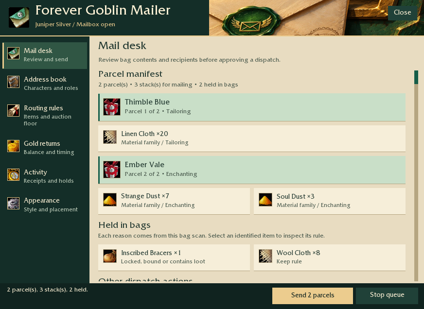
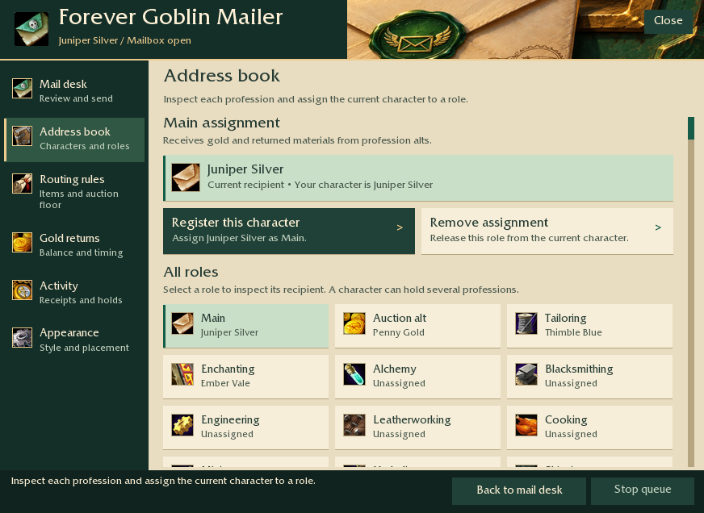
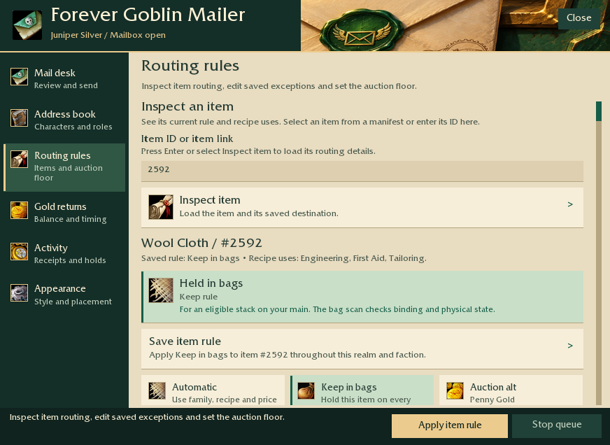
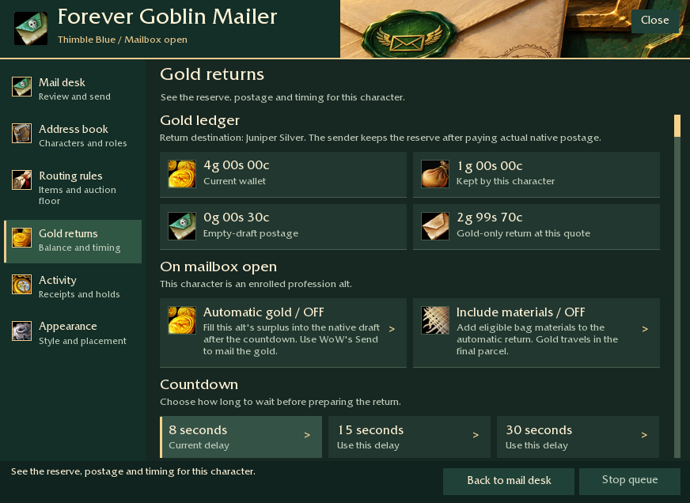
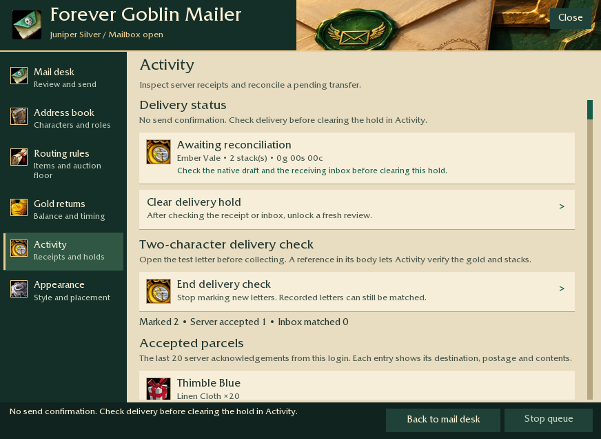
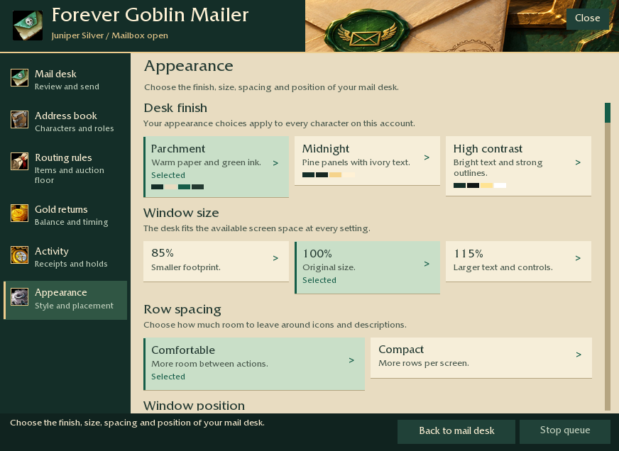

# Visual mail desk

**[Download Preview 4](https://github.com/LML-Studio/ForeverGoblinMailer/releases/download/v2.0.0-preview.4/ForeverGoblinMailer.zip)** · [Installation](https://github.com/LML-Studio/ForeverGoblinMailer/wiki/Install-and-first-use) · [Open the interactive tour](https://lml-studio.github.io/ForeverGoblinMailer/#desk-tour)

Open a mailbox to start on **Mail desk** or type `/fgm` to open **Address book**. The left rail stays within reach on every page. The text under an action explains its effect, and hover help explains prerequisites. These offline diagrams use the real Lua frames, synthetic characters and artwork from Forever build 71091. The gold ledger and Activity examples show Preview 4. The address book illustrates the numeric realm support introduced in Preview 3.

[Mail desk](#mail-desk) · [Address book](#address-book) · [Routing rules](#routing-rules) · [Gold returns](#gold-returns) · [Activity](#activity) · [Appearance](#appearance)

## Mail desk

Review the names, quantities and held reasons before pressing Send. Selecting an item opens its routing rule.

[Open this screen in the interactive tour](https://lml-studio.github.io/ForeverGoblinMailer/#tour-parcels)

## Address book

Check **Mail network** for the active realm and faction. Select a profession to see its owner. Register the character you are playing, verify the displayed full name, then confirm the assignment.

[Open this screen in the interactive tour](https://lml-studio.github.io/ForeverGoblinMailer/#tour-addresses)

## Routing rules

Inspect an item ID or link, select a destination and apply the rule. Automatic removes an override. The auction floor is a minimum price per unit.

[Open this screen in the interactive tour](https://lml-studio.github.io/ForeverGoblinMailer/#tour-rules)

## Gold returns

Choose **Gold to main → Fill gold draft**, verify the visible coins, then click the native **Send**. Check what stays on this alt. Set a whole-gold reserve of at least 1g, choose an 8, 15 or 30 second countdown, and decide whether to include materials.

[Open this screen in the interactive tour](https://lml-studio.github.io/ForeverGoblinMailer/#tour-gold)

## Activity

A receipt means the server accepted a parcel. Use **Start delivery check** in Activity or `/fgm check` to compare recorded letters. On the recipient, open the specific letter before collecting it. For an uncertain send, check the draft and receiving inbox before clearing the hold. [Check a live transfer](https://github.com/LML-Studio/ForeverGoblinMailer/wiki/Release-preview-4-checks#check-a-live-transfer)

[Open this screen in the interactive tour](https://lml-studio.github.io/ForeverGoblinMailer/#tour-activity)

## Appearance

Choose Parchment, Midnight or High contrast. Set the window to 85%, 100% or 115%, switch row spacing, or drag the header to float the desk.

[Open this screen in the interactive tour](https://lml-studio.github.io/ForeverGoblinMailer/#tour-appearance)

Changing routing or gold settings clears the current review. Run it again to see the new recipients and amounts. The final send reads the live postage and wallet again. [Dispatch and recovery](https://github.com/LML-Studio/ForeverGoblinMailer/wiki/How-the-addon-works#delivery-and-recovery)
